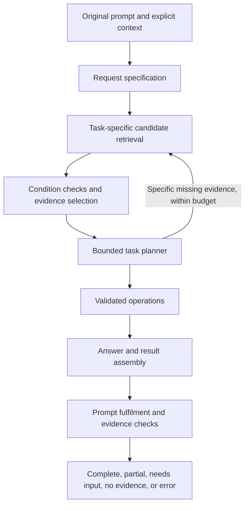

# Backend workflow audit and implementation handoff

Prepared 2026-11-15 against commit `1ae7c06` and graph `NASA-PSI-19-reviewed-2026-11-15`.

## 1. Instructions for the implementing LLM

Improve the backend from a user's prompt to a supported final answer, retrieved asset, table, plot or calculation. Preserve the user's requested conditions and outputs throughout the workflow. Treat this document as an implementation plan; verify the referenced code before editing because the repository may have moved on.

Work on backend contracts, interpretation, retrieval, evidence, planning, execution and output validation. Frontend design is outside scope. The HTTP adapter is relevant only where it alters backend inputs or bypasses the common workflow.

Implement incrementally in the phase order below. Begin with regression cases for the reproduced defects. Keep scientific evidence and execution validation strong: do not make more prompts appear successful by silently dropping conditions, filling calibrations from example files, treating unknown values as matches, or relabelling partial results as complete. Do not replace the entire project with a new framework or make a graph database, a larger LLM or a complete embedding rebuild a prerequisite for the first improvements.

For each phase, deliver the code, targeted tests, updated contracts/docs, benchmark comparison and explicit remaining limitations. All model/provider choices should remain configurable. Existing local and API planners need separate evaluations.

## 2. What was actually checked

This audit traced backend code, inspected the bundled graph and source artifacts, ran the root offline suite, and executed small deterministic probes against the real retriever and synthetic graph/planner fixtures.

- `.venv/bin/python -m unittest discover -s tests -v`: 78 tests, 77 passed, one plotting-render test skipped because the plotting extra is unavailable. Runtime was approximately 3.7 seconds in this environment.
- The checked-in `docs/reviewed-graph-validation.json` records eight passing cases with `gpt-4.1-mini`. These are historical results, not fresh live results from this audit.
- No paid model calls, fresh NASA downloads, full Qwen generation or full-graph embedding generation were performed.
- The probes establish specific mechanical defects. They do not establish how often a live model produces an incorrect plan.
- Existing tests primarily establish mechanics, contracts and a small number of retrieval examples. Passing them does not establish general prompt fulfilment or scientific answer quality.

Relevant graph facts, measured from the current loaded snapshot:

| Property | Observed value | Implication |
| --- | --- | --- |
| Investigations / Experiment nodes / Resources | 19 / 2,038 / 61,065 | Experiment nodes include campaigns, table rows, test days, parameter sets and scientific studies; they are not interchangeable physical runs. |
| Concept / Variable nodes | 44 / 78 | A useful vocabulary exists, but is not integrated consistently into the default retrieval path. |
| Resources marked `listed_public_unread` | 60,227 | Inventory coverage is much broader than content understanding. |
| Resources marked `structured_table_reviewed` / `reviewed_selected_sections` | 20 / 31 | Reviewed evidence is a small, valuable subset to prioritise. These are resource statuses, not counts of all scientific claims. |
| Resources marked `text_extracted_unreviewed` | 414 | Extracted text can support future retrieval, with its review status retained. |
| Resources with verified column profiles | 2 | Currently BASS-II and FLEX, added by the metadata overlay. |
| Resources with verified run IDs / file-wide conditions / related-file IDs | 0 / 0 / 0 | Generic run-compatible template execution cannot rely on these fields in the current snapshot. |
| JSON resources | 0 | The default graph contains no downloadable function-compatible JSON evidence templates. |
| Experiment canonical `conditions.gravity`, `oxygen_concentration`, `airflow`, `temperature` fields | 0 each | Connecting the existing semantic parser directly will not make its canonical filters work on most raw table records. |
| Experiment canonical `conditions.pressure` | 1, qualitative string | Numerical pressure filtering still needs a source-grounded normalisation layer. |
| Local extracted-source JSON files | 548 | These include different extraction outcomes; their presence does not mean all contain usable text or reviewed evidence. |
| Root `graph-embeddings.json` | 101 node vectors | This cache is not a complete index of the current 63,244-node graph. Existing fingerprint validation should reject/rebuild it. |

“Reviewed” denotes the repository's recorded source-review status. The review log includes assistant-authored interpretations; the label does not establish independent scientific validation. Keep original passages and locators available for checking those interpretations.

## 3. Current end-to-end behaviour

### 3.1 Default CLI workflow

`main` / `imperial-thermo-ai` delegate to `request_planner.service.main`; `thermo-execute` calls that same entry point.

1. Read a prompt and graph configuration, or accept an existing `SearchResults` object/file.
2. Unless precomputed search results are supplied, call `load_graph(...).search(prompt)` in `reviewed_graph.py`.
3. Return at most six file records by default.
4. Call `run_workflow(prompt, results, OpenAIPlanner(...))`.
5. The planner chooses `inspect_files`, `calculate`, `retrieve_assets` or `no_match`.
6. Python validates the proposed plan. Inspection can enrich the same candidate list and lead to another planning round, up to three rounds total.
7. Download selected measurement files temporarily, execute an allowlisted operation, or return asset links without downloading them.
8. Return `FrontendResponse`, which is also the backend result envelope. Its `message` generally comes from the planner's explanation written before execution. There is no general post-execution answer synthesis or fulfilment check.

### 3.2 Local-model backend adapter

`NASA Space Apps/frontend/standin/server.py` with `AI_PROVIDER=thermo` calls `standin/thermo.py::ask`.

- The server truncates the question to 600 characters before processing it.
- `ask` runs the same lexical graph search and uses the cached local `Qwen/Qwen3-4B-Instruct-2507` as an action planner.
- It does **not** call `QuestionParser.parse` to create a semantic search plan. It uses `QuestionParser` as the model-loading/generation wrapper.
- The adapter sends only the question into this workflow; the history/persona/scenario fields received by the HTTP endpoint are not passed through.
- The model lock covers model loading and the entire workflow, including inspection/downloads and calculations.
- It supplies a 60-second additional planning allowance; model loading and lock waiting occur before the workflow deadline starts.
- A narrowly worded PMMA thickness-comparison regex bypasses retrieval and the planner, using the bundled THM-05 example/calibration directly. A THM-01-specific summary is also added in this adapter.

These differences mean the same prompt can take a different path depending on its entry point. Consolidate backend orchestration and result composition so the adapter becomes thin.

### 3.3 Alternative structured and vector paths

The repository already contains useful components:

- `parser.py` and `flat_prompt.txt`: interpret a prompt into criteria, requested fields, comparison groups and clarifications.
- `semantic_plan.py`: compile semantic criteria into graph traversals.
- `query_plan.py`: validate syntax, types, routes and quoted input spans.
- `graph_search.py`: evaluate conditions with true/false/unknown semantics and return graph hits with paths and condition details.
- `search_files.py` and `vector_search.py`: optional CLI retrieval using query/node embeddings and optional structured conditions.

These are separate paths. The default CLI and local adapter do not use their semantic interpretation or embedding retrieval. The vector path ultimately flattens its output back to `{query_id, files}`, losing most of the richer query information. Its “global” mode means scoring resource vectors across investigations, not global scientific synthesis or community-summary GraphRAG.

### 3.4 Current retrieval and execution mechanics

Lexical retrieval indexes resource metadata plus owning experiment/investigation context. It scores each matching direct token at +3 and each matching context token at +1, adds a +12 role preference for some words, and uses reviewed status only as a tie-breaker. It has no inverse document frequency, semantic reranking, calibrated no-match decision or diversity constraint. Explicit PSI IDs and recognised campaign title aliases restrict investigations.

The executor supports CSV column inspection, bounded JSON previews, plotting two complete CSV columns, and THM-01 through THM-20 through allowlisted Python entry points. It does not currently provide row filtering by requested experimental conditions, aggregation, general unit conversion, table joins or semantic reading of PDFs/videos. Most modern THM models require sourced JSON evidence; legacy adapters permit parameter inputs subject to their own validators.

## 4. Findings and priorities

P0 means a correctness or prompt-fulfilment issue to fix before broader automation. P1 means an important coverage/retrieval improvement. P2 means performance and maintainability work after correctness is established.

### F01 — P0: The prompt is not a persistent contract

The default retrieval path receives raw text; the action planner independently interprets it. `validate_plan` receives files and execution limits but no structured representation of the requested task. It validates that an action is executable, not that it answers the question.

**Reproduction:** inject a valid `retrieve_assets` plan into `run_workflow` for “Calculate flame spread at 30% oxygen and plot the results.” A document-only response is marked `completed`. No live LLM is needed to reproduce this missing guard.

**Required change:** introduce a persistent request specification with required deliverables, conditions, comparisons and input provenance. Validate the proposed action against it before execution and the output against it afterward.

### F02 — P0: Graph query bindings can satisfy conditions on different witnesses

`semantic_plan.compile_plan` groups some criteria by node type but compiles Concept/Variable conditions independently. For a Resource linked to several Experiments, its gravity condition can match one experiment while its topic condition matches another. Grouping by node type is not sufficient to preserve “the same experiment.” Similar care is needed for a variable's name/unit/role and for separate requested assets.

**Reproduction:** a file links to experiment A with microgravity and experiment B with normal gravity plus an ignition Concept. A Resource query requiring microgravity and ignition evaluates `True`, although no experiment supplies both.

**Required change:** represent explicit witness/binding scope and compile all conditions on a required experiment into the same traversal. Preserve exact satisfying paths and row IDs. Distinguish “a file contains evidence of both groups” from “one experiment satisfies all conditions.”

### F03 — P0: Vector file projection can lose the requested resource constraint

`VectorGraphSearch._finish` checks each file by routing from Resource to the query's original return type. If the query asks for Experiments with a PDF, a CSV from that experiment can pass because the experiment has a different PDF resource.

**Reproduction:** an experiment has one CSV and one PDF. An Experiment query with Resource `file_format=pdf` yields both files, each labelled as having matching requested metadata.

**Required change:** explicitly distinguish experiment discovery from returned-file selection. If the requested deliverable is a PDF, enforce the condition on that returned resource. Project evidence through the satisfying paths, not through an arbitrary shared owner. Add tests for both legitimate “find experiments that have PDFs” and “return those PDFs” requests.

### F04 — P0: The graph's raw metadata does not match the semantic query vocabulary

Source table fields remain under their original headers, often with spaces/punctuation and string values. The parser expects canonical keys such as `conditions.oxygen_concentration`; filter paths only allow identifier-like segments. `graph_catalogue` exposes raw paths but limits each type to 100 alphabetically sorted fields, and samples at most 80 vocabulary entries in graph order. The audited sample included only seven of the 19 investigations.

**Reproduction:** BASS-II row `exp:PSI-25:table:a8a37c3002bb8108a044:row:2` records initial oxygen as string `22.2` under `Calibrated  initial O2 % by vol`. A canonical oxygen filter returns unknown because that canonical property is absent.

**Required change:** build a versioned, source-grounded normalised overlay while preserving the raw graph. Use canonical property identifiers, typed values/ranges and explicit unit/basis/stage/scope metadata. Do not infer file-wide conditions from one row or fill gravity from campaign association without supporting evidence.

### F05 — P0: Numeric bindings validate units but not the meaning of a quantity

`Variable` carries name, unit and numeric suitability. `INPUT_UNITS` checks destination units but does not model chemical basis, species, stage, measurement role or physical scope.

**Reproduction:** `apply_bindings` accepts a CSV column named “oxygen mole fraction”, unit `1`, into `/params/y_ox_stream`, the mass-fraction input used by THM-03. The resulting value is copied unchanged. Matching dimensionless units is insufficient.

**Required change:** introduce quantity contracts for source columns and model inputs. Check quantity kind, species, mole/mass/volume basis, initial/final stage and run/scope as well as unit. Require a registered, auditable conversion with all required inputs for any transformation. Unknown basis remains unknown.

### F06 — P0: Completion and the final answer are tied to actions, not user intent

`service.run_workflow` marks any successful non-inspection action complete and stops. It cannot naturally complete several calculations, a comparison followed by explanation, or an inspection-only request. A successful inspection may end as `needs_input` or `no_match` even when inspection was the entire request. Its main message usually describes intended selection/calculation rather than the actual result.

The historical eight-case validation counts its inspection case as passing even though the status is `needs_input`, demonstrating a weak success criterion in the evaluation itself.

**Required change:** use per-deliverable completion, explicit terminal inspection, and a final result assembler grounded in actual execution/evidence. Preserve partial outputs with truthful overall status.

### F07 — P1: Lexical retrieval ignores several important distinctions

- `Find BASS-II experimental table at 21% oxygen` and the same question at 30% return the same six files. Returning the same multi-condition table can be valid, but there is no downstream row filter establishing the requested condition.
- `Find BASS-II videos excluding PSI-25` returns PSI-25 videos. Explicit ID scoping does not understand negation or the contradiction between the alias and exclusion.
- `PSI-25 quantum banana zebra` still returns six records. Scoped retrieval admits zero-relevance resources.
- `Find experimental table for PSI-25 and PSI-99999` returns PSI-25 files without structured coverage saying that the second investigation is unavailable.
- Alias matching is based on campaign title prefixes, not a complete entity resolver. An explicit PSI mention suppresses alias-based scoping, so contradictory name/ID mentions need explicit handling.

**Required change:** resolve entities and constraints before retrieval, preserve positive/negative scopes and group coverage, and distinguish a browse/list request from a substantive question with no supporting match.

### F08 — P1: Early top-six truncation is not aware of evidence usefulness

Truncation happens before planner eligibility checks. Citation-only records, unsupported archives and oversized downloads compete with usable sources. For “How does pressure affect ignition?”, four of six retrieved records were citation-only records with no download URL; `build_request` subsequently removes them. For BASS-II table queries, five of six candidates were ZIP resources, several well above the download cap.

**Required change:** generate a larger candidate pool, preserve separate scientific-evidence and executable-data lanes, apply task-specific eligibility, deduplicate and rerank, then pack a bounded context. Citation records may be useful for bibliography, but do not establish paper contents. Avoid treating every raw archive as an inspectable measurement table.

### F09 — P1: Replanning cannot repair retrieval

The three workflow rounds can inspect only files in the original result list. They cannot retrieve a missing calibration, related report or alternative dataset. `related_file_ids` would be insufficient without a resolver even if populated, and are currently empty in the snapshot.

**Required change:** allow bounded retrieval of specific missing evidence, preserving the original question and constraints. Stop on no progress, repeated file/operation selection or exhausted budgets; report exactly what remains missing.

### F10 — P1: Rich graph information is lost at the file-only boundary

`SearchResults` forbids extra fields. It cannot carry comparison groups, query criteria, per-condition evaluations, matched rows, evidence passages, exact locators or numeric retrieval diagnostics. Vector retrieval uses the query predicates but drops requested fields, clarifications and group membership. The graph adapter exports resource summaries as notes, not the associated reviewed experiment findings and their supporting passages.

**Required change:** add a versioned internal retrieval/evidence envelope. Keep a compatibility adapter for the existing file contract; do not inject extra fields into an `extra='forbid'` model.

### F11 — P1: The available evidence is not indexed for scientific answers

The reviewed graph contains scientific findings in Experiment summaries and supporting edge evidence. `document_review_log.json` and `sources/*/extracted/*.json` include source text and locators. The runtime currently retrieves file metadata and presents PDFs/videos as links. There is no supported explanation action or evidence-to-answer stage.

**Required change:** index source sections/claims with stable IDs, source hashes and locators, then compose answers from selected evidence. Link each asserted scientific point to evidence and retain its tested conditions and limitations. Use extracted-but-unreviewed material with an explicit status; do not call it reviewed or infer that videos were analysed.

### F12 — P1: Registering 20 functions does not make 20 data-backed tasks feasible

Fourteen modern models require downloaded evidence. The current graph has no JSON resources or verified file run IDs, so the generic modern-model JSON/template execution path lacks the required inputs in this snapshot. Only two CSV profiles are available. Many legacy functions also have defaults and optional solver backends that should be reported as assumptions/implementation choices.

The workflow also unnecessarily requires a measurement file for a fully specified, user-requested theoretical calculation that could be executed safely from explicit parameters.

**Required change:** add a model capability and evidence-availability matrix; create sourced evidence packages only where source material supports them. Provide a separate typed parameter-only calculation path for suitable models. Distinguish observations, data reductions, scenario estimates and calibration-derived predictions in outputs.

### F13 — P1: Function discovery and contracts are incomplete

`operation_catalog` derives shapes from bundled examples. These shapes do not fully describe required/optional inputs, units, defaults, applicability or admissible source types. `_local_catalog` includes full shapes only for explicit THM IDs and two phrases: “lewis number” and “adiabatic flame temperature”. A natural-language request for opposed-flow flame spread therefore omits the THM-05 input shape.

**Required change:** maintain explicit model schemas and quantity contracts. Select candidate functions semantically/deterministically from the requested analysis, then provide complete contracts for those candidates. Examples remain examples, never evidence or silent defaults.

### F14 — P1: The data operations cannot express common requests

CSV plots use complete columns; scalar bindings use a zero-based row index; records/series use entire columns. There is no operation for selecting rows at a requested condition, grouping by test ID, filtering a parameter range, comparing groups or requesting multiple plots/calculations. One bad value can render a whole column unusable, even when a documented selection could provide a valid subset.

**Required change:** introduce a small allowlisted table-operation language with typed predicates, explicit row provenance and declared missing-value policy. Add safe conversions and simple aggregates incrementally. Never join recordings by filename guess, treat row position as shared time, silently drop bad values or interpolate when the user requested measurements.

### F15 — P1: The budget incorrectly rejects link-only media

`validate_plan` adds asset sizes to the same download budget as measurement files, while `ExecutionSession.execute` only returns asset links. A 200 MB PDF/video link is rejected although the server will not download it. Existing tests intentionally encode this current behaviour and need a deliberate contract change.

**Required change:** separate link selection, server-side transfers and model evidence-extraction budgets. Returning a link must not claim content analysis or live availability verification.

### F16 — P1: Profile provenance is recorded but not enforced against bytes

`read_graph` attaches verified columns using matching source URL and byte count. The profile hash is placed in text notes. `fetch` computes a downloaded hash but does not compare it to a trusted expected hash. A source changed to different bytes of the same length can retain stale semantic metadata.

**Required change:** carry a structured trusted expected hash/version and bind every derived profile/chunk/evidence package to it. On mismatch, invalidate or reprofile derived metadata before calculation. Preserve the current observed hash for reproducibility.

### F17 — P2: Performance costs and limits are not end-to-end

The optional vector implementation performs Python dot products for all nodes and stores vectors as JSON/Python lists. Local graph expansion is hop-bounded but traverses every adjacent edge type without a total node/edge budget; shared concepts and campaign hubs can produce large candidate sets. Resource descriptions concatenate inherited context and truncate it, so long tables have order-dependent representation.

The local model's input limit, generation token cap, loading time, queueing time and workflow timeout are separate. The lock serialises unrelated I/O and computation with inference. `max_time` is passed into model generation, but this code has no independent process-level interruption for a stalled load or long generation step. The README's CPU completion caveat is historical; benchmark current hardware separately.

**Required change:** structured timing and budgets first; compact matrix/vector storage and bounded typed graph expansion when measured need warrants it; a warm model worker with queueing, cancellation and a real outer deadline. Keep lexical operation available when dense indexing is unavailable.

### F18 — P2: Documentation and evaluation have drifted

`docs/search-results-contract.md` says plotting is the only calculation, although `run_thermo_model` is implemented. The documented claim that ambiguous provenance raises an error differs from `_provenance` returning `None` and callers skipping that resource. The root embedding artifact covers a different/smaller graph. Forty parser fixtures exist, but they do not provide an end-to-end retrieval/answer benchmark.

**Required change:** update docs from versioned contracts, report skipped/invalid resources explicitly, and evaluate exact prompt fulfilment rather than merely presence of a block type.

## 5. Target backend architecture

The request specification and evidence trace travel through every stage. The model proposes interpretations, selections and prose; Python checks IDs, conditions, quantities, admissible operations and completion requirements. A final LLM judgement may assist review, but must not be the only validator.

### 5.1 New internal contracts

Use new versioned models rather than silently expanding the existing v1 wire payload. Suggested shapes:

| Contract | Required information |
| --- | --- |
| `RequestSpec` | Original prompt; normalised text; task IDs/intents; required outputs; positive and negative entity scopes; conditions with source spans and binding scope; comparison groups; requested fields; explicit user inputs; assumptions policy; unresolved clarifications. |
| `QuantityDescriptor` | Canonical quantity; raw source header; value/range where applicable; unit; species; basis; stage; physical scope; experiment/row identifiers; review status and source locator. Unknowns remain explicit. |
| `RetrievalBundle` | Graph/data version; original task/group IDs; candidate files and evidence items; rank components; eligibility; exact satisfied/conflicting/unknown conditions; satisfying paths/rows; per-group coverage; retrieval attempts. |
| `EvidenceItem` | Stable evidence ID; resource and investigation IDs; source hash/version; page/section/slide/table-row locator; bounded passage or structured fact; observed/modelled/planned classification; tested conditions; limitations; extraction/review status. |
| `TaskPlan` | Bounded steps with dependencies; selected source IDs; operation and model IDs; typed arguments and their origins; expected outputs; budgets; missing evidence or user input. |
| `ExecutionResult` | Actual operation/model version and solver; resolved inputs; output quantities; source hashes and selected rows; transformations; diagnostics; elapsed time. |
| `AnswerResult` | Answer text or structured findings; claims with evidence references; calculation/plot/table/asset results; per-task fulfilment; missing requirements; assumptions; overall status; trace ID. |

Each numeric input origin must be one of: explicit user input, verified source cell/value, registered transformation, or an explicitly permitted and reported model default/assumption. Model-created evidence is not an origin.

Clarifications must be represented in the backend result, so any future client can ask them. Retrieve useful independent evidence while a requirement is unresolved, but do not execute a dependent calculation on guessed values.

For status, distinguish `completed`, `partial`, `needs_input`, `no_evidence`/`unsupported` and `error` internally. Map to the old response contract conservatively until clients opt into v2. Technical failures must not masquerade as scientific absence of evidence.

## 6. Implementation phases and acceptance criteria

### Phase 0 — Capture the baseline and correctness regressions

**Work:** create offline regression cases for F01–F06 and F15–F16; add labelled real-graph retrieval probes for F07–F08. Retain current known-good report/video/plot/THM cases. Store the graph ID/hash, configuration and expected outcome for reproducibility.

**Acceptance:** the new cases expose today's defects before fixes; the baseline report distinguishes retrieval, planning, execution and fulfilment. No live model is required for structural regressions. Existing safeguards remain tested.

### Phase 1 — Establish request and fulfilment contracts

**Likely files:** `request_planner/models.py`, a new backend orchestration module, `request_planner/service.py`, `imperial_thermo_ai/parser.py`, `query_plan.py` and planner adapters.

1. Add the versioned internal contracts and v1 adapters.
2. Introduce one prompt-interpretation interface for local/API models, reusing existing semantic-plan parsing where appropriate. Preserve exact source spans, all requested outputs and numbers.
3. Resolve known PSI IDs/acronyms against a complete compact catalogue. Detect unknown and contradictory entities; do not convert negative mentions to positive scopes.
4. Separate required conditions from topics, optional requested fields and scenario assumptions. Comparisons have named groups. “How does X affect Y?” must not automatically require X to be a measured channel.
5. Add pre-execution task compatibility and post-execution fulfilment checks. Inspection can terminate successfully. A document link cannot satisfy a requested calculation or a summary of that document.
6. Preserve the full prompt up to an explicit backend limit. Reject an over-limit request with a clear diagnostic instead of silently slicing it. Thread explicit context through the backend interface.

**Acceptance:** the wrong-action probe no longer reports completion; inspection-only requests complete; multi-part requests report missing parts; contradictory IDs produce clarification; trailing conditions are never silently lost. V1 callers and saved requests still have an explicit supported route.

### Phase 2 — Repair graph semantics and normalise source metadata

**Likely files:** `semantic_plan.py`, `graph_search.py`, `vector_search.py`, a new versioned metadata overlay and quantity schema.

1. Add witness/binding scope to query compilation. Test conditions that must hold on the same experiment, row, variable and resource.
2. Return the exact paths and entities that satisfy each query. Repair projection to returned resources; retain comparison membership and requested fields.
3. Build a canonical metadata overlay starting with the 20 reviewed tables. Maintain raw headers/values and explicit mappings; parse known numerical fields/ranges, units and missing values without guessing.
4. Model table-row membership separately from verified physical-run identity. Campaign edges and table row numbers are insufficient to join separate datasets.
5. Build a stable, task-relevant schema catalogue rather than truncating an arbitrary alphabetical raw-field list. Include all investigation names and aliases; retrieve additional schema detail when needed.
6. Preserve true/false/unknown semantics and open-world relationship handling. Never assert “no paper exists” solely because this snapshot lacks a relationship.
7. Add the initial source/destination quantity compatibility gate now, before broader execution: reject known basis/species/stage mismatches and missing required semantics. Broader conversions and model coverage can follow in Phase 5.

**Acceptance:** both graph-scope reproductions are fixed; the mole-to-mass mapping is rejected; the BASS-II oxygen row supports the correctly scoped canonical initial-volume-percent predicate; raw evidence is unchanged; unsupported mappings remain unknown. No cross-row condition conjunction is accepted as a single-run match.

### Phase 3 — Improve retrieval in measurable steps

**Likely files:** `reviewed_graph.py`, `vector_search.py`, `search_files.py`, `graph_files.py`, new retrieval orchestration and evaluation fixtures.

1. Replace the fixed top-six handoff with task-specific candidate generation and context selection. Begin with a configurable lexical pool, for example 40–100 candidates; tune these values using evaluation rather than treating them as facts.
2. Implement field-weighted lexical retrieval with term rarity, exact entity/title matches and typed resource intent. Preserve exact PSI scoping and unknown-ID behaviour.
3. Add a separate passage/claim retrieval lane as Phase 4 makes evidence available. Treat downloadable calculation inputs, explanatory evidence and bibliographic discovery as different capabilities.
4. Optionally fuse dense candidates with lexical candidates by rank. Do not replace exact identifiers/numeric checks with cosine similarity. Evaluate lexical-only and hybrid configurations separately.
5. Apply hard verified conflicts and output-specific eligibility. Preserve unknown-condition leads as labelled candidates, never as satisfied measurements. Handle all-unknown or no-relevance results explicitly.
6. Rerank and deduplicate by source/evidence identity; reserve coverage for requested comparison groups and required source types. Pack by token budget and evidence usefulness rather than an arbitrary fixed count.
7. Bound graph expansion by allowed relation types, entity scopes, fanout and total nodes/edges. Shared concepts can suggest related studies, but cannot transfer experimental conditions between them.
8. Add bounded retrieval expansion when a task identifies a particular missing report, variable, calibration or dataset. Preserve hard constraints and log every attempt.
9. Make embedding caches reproducible: graph/content hashes, document construction version, model revision, tokenizer/pooling/query instruction and dimensions. Incrementally rebuild changed evidence; use compact vector storage before scaling the full index.

**Acceptance:** fewer unselectable candidates occupy execution context; exact report lookup remains correct; unknown investigations are represented per group; unrelated scoped questions can return no relevant evidence; hybrid improvements are demonstrated on a held-out set before becoming default.

### Phase 4 — Build evidence retrieval and grounded answer composition

**Likely files/data:** `src/reviewed_knowledge_graph/output/document_review_log.json`, `resource_coverage.json`, graph edge evidence, `sources/*/extracted/*.json`, a new evidence index and answer composer.

1. Ingest available source sections and reviewed findings, retaining resource IDs, source hashes, original locators and extraction/review status. Exclude missing/failed content and record why.
2. Define stable chunk IDs tied to source version and locator. Keep scientific context and limitations with a finding. Do not cut a reported conclusion away from its applicable conditions or qualifier.
3. Build a claim-to-source mapping; a review entry with several locators may require a person to verify which locator supports which claim. Do not automatically attach every listed page to every sentence.
4. Package or mount the evidence index explicitly for runtime use. Extracted source files are not currently included just by installing the graph package; do not depend on obsolete `local_path` entries inside extraction records.
5. Add explanation/summarisation outputs grounded in retrieved evidence. Return citations resolving to resource + version + locator. Preserve conflicting findings and differences in geometry, flow, fuel and measurement methods.
6. Assemble calculation explanations after execution, using actual resolved inputs and outputs. Cite computation provenance separately from source claims. Do not let the answer model recalculate numerical values from prose.
7. Validate citation existence, source/claim linkage, numerical consistency and required-output coverage. Use human-reviewed evaluation for substantive entailment; syntactic citation checks alone cannot establish scientific correctness.

**Acceptance:** a supported explanation produces an answer with precise supporting locators; “show the report” and “summarise the report” have different fulfilment criteria; unavailable evidence produces a specific limitation; unsupported scientific claims do not receive a completed status.

### Phase 5 — Improve scientific execution and model selection

**Likely files:** `function_registry.py`, `planner.py`, `execution.py`, new quantity/model contracts and reviewed evidence-package registry.

1. Replace example-derived input shapes with explicit per-model contracts: required/optional inputs, quantity semantics, admissible units, defaults, applicability/calibration domains and output definitions. Keep module paths allowlisted.
2. Implement source-to-input quantity checks. Block the mole-to-mass binding reproduction. Add only registered conversions and record formulas/constants and required composition inputs.
3. Add a separate parameter-only scenario operation for compatible models. Require sufficient explicit user inputs or permitted documented defaults; do not force an unrelated NASA CSV into the calculation.
4. Add audited row selection and simple table operations. Preserve source row identifiers, selection predicates, transformation history and an explicit missing-value policy. If no row satisfies a requested condition, report that; do not use a neighbouring row silently.
5. Build evidence packages for a small, scientifically supportable subset of modern THM models first. Bind calibrations to source locators, material/geometry, applicable ranges and hashes. Keep unsupported models listed with their exact missing evidence requirements.
6. Support bounded task dependencies and multiple operations for comparisons or multi-output questions. Share inspected/downloaded data safely; do not join incompatible runs.
7. Move the PMMA shortcut into a general, typed, source-backed recipe if its calibration is retained. Apply the same intent, assumption, provenance, applicability and completion checks as every other calculation. Put the THM-01 result summary in common backend composition.
8. Include solver/backend version, defaults used and model limitations in results. Use explicit output schemas for chart axes and units rather than relying solely on numeric-array names.
9. Separate link budgets from transfer budgets. Bind profile validity to verified source bytes and invalidate stale profiles on hash mismatch.

**Acceptance:** every numeric argument has a permitted origin; scientific quantity mismatch is rejected before calculation; required assumptions are surfaced; filtered plots contain exactly the selected rows; output includes each requested comparison group or names the missing group. Never claim that all 20 models are usable on real NASA data solely because all modules load.

### Phase 6 — Runtime, observability and rollout

1. Make CLI and HTTP routes thin clients of the same orchestration interface, with explicit provider configuration and parity tests.
2. Trace interpretation, candidate retrieval, condition evaluation, context packing, planner calls, inspection, execution, synthesis and validation. Record model/index/graph versions, token counts where available, retries and reason codes.
3. Apply an outer request deadline covering queueing, loading, retrieval and generation, with bounded phase budgets and cancellation. Limit the inference lock to inference; use isolated execution sessions for concurrent requests.
4. Cache immutable graph/evidence indexes and verified profiles by content hash. Avoid re-downloading/re-profiling the same immutable source unnecessarily, with explicit cache lifetime/storage policy.
5. Profile lexical, dense and local-model latency separately on the target hardware before selecting default models and context sizes. Keep a useful retrieval-only path if model generation is unavailable.
6. Update docs and machine-readable schemas together. Remove misleading cache artifacts from default assumptions and expose coverage failures instead of silently skipping them.
7. Roll out behind backend configuration flags. Compare old and new retrieval offline or in shadow evaluation before making v2 default; retain an explicit v1 adapter until consumers migrate.

**Acceptance:** no unexplained indefinite waits; timeouts preserve completed partial outputs and explain the failing stage; identical request specifications yield equivalent intent/coverage across entry points; benchmark records make regressions attributable to a specific stage.

## 7. Evaluation design and release gates

Start with about 120 adjudicated prompts, balanced across discovery, explanations, inspection, plots, calculations, comparisons and unsupported/ambiguous requests. Include all 19 investigations where suitable. Split by prompt family and investigation/source where practical so near-identical paraphrases do not leak into both tuning and held-out sets. Keep gold answers limited to what the reviewed evidence actually establishes.

Each case should record: prompt; expected task(s); preserved constraints; acceptable source IDs/passages; prohibited substitutions; expected rows/quantities when computable; expected status; required limitations; and whether it is answerable with the frozen evidence snapshot.

| Test family | Required examples and checks |
| --- | --- |
| Exact discovery | CFI final science report versus SRD/SCR; video identity; exact filename and PSI ID; typo and alias variations. |
| Relevance/coverage | Unrelated question with a PSI ID; unknown PSI alone and mixed with a known PSI; comparison groups with unequal source counts; citation-only resources crowding usable evidence. |
| Conditions | Initial versus final oxygen; mass versus mole/volume basis; 21% versus 30%; ranges versus exact values; lunar gravity versus microgravity; missing units and ambiguous qualitative conditions. |
| Graph binding | Different experiments independently satisfying conjunctions; different Variables supplying name/unit; a sibling PDF incorrectly qualifying a CSV; same-table different-row conditions. |
| Intent | Show versus summarise a report; inspect-only success; calculate-and-plot fulfilled together; multiple calculations; partial answers; an explanation without a calculation request. |
| Data selection | Exact row/run identity; zero matching rows; out-of-range indices; numeric columns with bad values outside/inside the selected subset; PSI-117 unequal time axes never joined by row number. |
| Model inputs | Mole fraction cannot map directly to mass fraction; missing calibration; out-of-domain calibration; explicit scenario-only computation; default assumptions exposed; incompatible templates rejected. |
| Provenance | Same-size changed download invalidates trusted profile; citations resolve to real locators; extracted versus reviewed text is distinguished; returned link does not imply content was read. |
| Robustness | Unsupported archive/format, provider error, malformed output, unavailable source, prompt truncation boundary, metadata injection, stale cache and budget exhaustion. |
| Output verification | Correct status, complete requested outputs, numerical agreement with executor, visible assumptions, claim-level evidence and no unsupported scientific conclusion. |

Suggested initial release targets, to be confirmed after measuring the baseline:

- Zero violations in the deterministic adversarial suite for experiment/row binding, known contradictory conditions, invented sources, quantity basis and unsupported completion.
- At least 95% top-1 accuracy for adjudicated exact-document retrieval, with case counts reported.
- At least 90% Recall@20 for necessary evidence on answerable held-out questions, reported per task family; use evidence-set coverage for multi-source comparisons rather than only single-file recall.
- At least 90% exact fulfilment of all required deliverables on the answerable held-out set; report partials and abstentions separately rather than excluding them.
- At least 90% correct clarification/abstention behaviour on ambiguous or unsupported cases, and separately report false abstention on answerable questions.
- All citation IDs/locators resolve; at least 95% supported scientific claims in an adjudicated answer sample. Report numerical consistency and factual support independently.
- Report p50/p95 latency, memory, context size, repair rate, downloads and cost by task/provider/hardware. Set latency targets after baseline measurements; a single target for links, full data inspection and CPU inference would be misleading.

Run deterministic tests in normal CI. Run live local/API comparisons as explicit, bounded evaluation jobs. Report lexical-only, lexical+dense and reranked variants as ablations so improvements can be attributed to components rather than only to a new model.

## 8. Suggested first implementation batch

The first reviewable batch should contain:

1. Regression fixtures for wrong-action completion, terminal inspection, cross-experiment bindings, sibling-resource projection and mole/mass confusion.
2. `RequestSpec` plus a minimal required-output verifier, integrated into the common backend service.
3. Query binding/projection fixes with explicit evidence paths.
4. A BASS-II/FLEX quantity overlay preserving initial/final and mole/mass/volume distinctions, plus a binding validator that rejects incompatible or insufficiently specified quantities, as the starting point for all reviewed tables.
5. Task-aware lexical candidate selection that avoids filling the executor context with unusable sources, plus explicit per-group coverage.
6. A benchmark report showing exactly which problems are fixed and which explanation/execution capabilities remain unavailable.

Then add source-passage retrieval and post-execution answer composition. Dense retrieval should earn its place through measured retrieval improvements. A larger model cannot repair missing evidence, incompatible quantities or absent completion criteria on its own.

## 9. Code navigation

| Area | Current implementation |
| --- | --- |
| CLI/default entry point | `src/imperial_thermo_ai/main.py`; `src/request_planner/service.py::main` |
| Default lexical retrieval | `src/imperial_thermo_ai/reviewed_graph.py::ReviewedGraphSearch.search`, `read_graph`, `load_graph` |
| Graph/file mapping | `src/imperial_thermo_ai/graph_files.py::GraphFileRecords`, `file_kind` |
| Semantic interpretation/validation | `src/imperial_thermo_ai/parser.py`, `flat_prompt.txt`, `query_plan.py` |
| Query compilation/evaluation | `src/imperial_thermo_ai/semantic_plan.py`; `graph_search.py::evaluate`, `search_graph` |
| Optional dense retrieval | `src/imperial_thermo_ai/search_files.py`; `vector_search.py::documents`, `VectorGraphSearch._finish`, `local_search`, `global_search` |
| Plan validation/model context | `src/request_planner/planner.py::validate_plan`, `build_request`, `LocalPlanner`, `OpenAIPlanner`, `_local_catalog` |
| Workflow/status | `src/request_planner/service.py::run_workflow` |
| Execution/quantity mapping | `src/request_planner/execution.py::ExecutionSession`, `apply_bindings`, `INPUT_UNITS`, `present_result`; `worker.py` |
| Function contracts/dispatch | `src/request_planner/function_registry.py`; `src/Functions/` |
| Existing result models | `src/request_planner/models.py`; `src/imperial_thermo_ai/file_contract.py` |
| Local backend adapter | `NASA Space Apps/frontend/standin/thermo.py`; `server.py::do_POST` |
| Source evidence | `src/reviewed_knowledge_graph/output/`; `src/reviewed_knowledge_graph/sources/*/extracted/`; `src/imperial_thermo_ai/reviewed_file_metadata.json` |
| Tests/evaluation | `tests/`; `examples/parser_cases.json`; `examples/validate_reviewed_workflow.py`; `docs/reviewed-graph-validation.json` |

This plan deliberately preserves the strongest existing components: allowlisted functions, stable file IDs, source-size/hash recording, public-destination checks, temporary execution isolation, explicit unknown units, run-compatibility checks and bounded repair. The improvement is to connect these checks to a richer representation of the user's request and the evidence needed to satisfy it.
