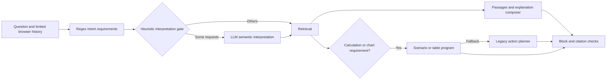
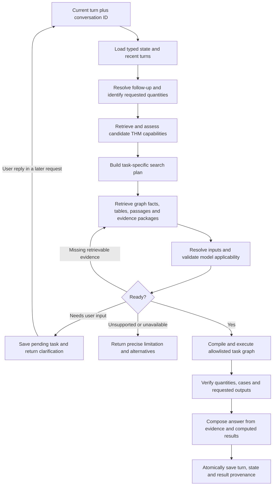

# Search, scientific model routing, and conversation memory: implementation plan

Prepared 2026-11-15 from the current `test` branch and its uncommitted worktree.
This is a design and implementation handoff. The features below are proposed;
their inclusion here does not mean they have been implemented or evaluated.

## 1. Objective and scope

Improve the complete prompt-to-answer workflow so the application:

1. Recognizes a calculation, comparison, parameter sweep, or data reduction even
   when the user does not say “calculate” or name a THM model.
2. Selects an applicable scientific function and explains why it was selected.
3. Searches the correct investigations, runs, datasets, and passages for that task.
4. Remembers the last few turns, confirmed inputs, selected sources, and unfinished
   tasks within a conversation.
5. Asks specific questions when essential information is missing, then resumes
   the original task after the user responds.
6. Produces outputs checked against the requested quantities, cases, conditions,
   and deliverables, rather than merely checking whether a function returned.

Here, **LLM** means the language model interpreting and explaining requests;
**scientific model** means an executable THM function. Keep these separate in code,
logs, and user messages. Improving scientific model usage means correctly
selecting and preparing computations, rather than simply increasing LLM calls.

This is a backend-led change with the small API/client changes needed for real
conversations and clarification forms. A visual redesign is outside this scope.
Reuse the current Python/Pydantic service, graph, search modules, and allowlisted
execution workers. A new agent framework or graph database is unnecessary.

## 2. Current behavior and concrete causes

These observations come from static source inspection and reading the packaged
graph/index. No fresh LLM calls, scientific validation, or test runs were performed
for this planning task. Existing uncommitted implementation work must be preserved.

### 2.1 Current pipeline



The following files are the main implementation entry points:

| Area | Current source | Observed gap |
| --- | --- | --- |
| Intent | `src/request_planner/intent.py::interpret` | Regex keywords plus a few special cases for Lewis number and thickness changes drive computational routing. These do not cover general numerical phrasing or all 20 models. |
| Interpretation | `backend.py::_answer`, `interpretation.py::enrich` | `scenario_only` and `simple_content` can skip semantic interpretation. A request misclassified as an explanation may never acquire a calculation task. |
| Model inference | `interpretation.py::enrich` | Generated model-specific requirements are rejected unless the THM ID literally occurs in the current prompt; this prevents general semantic model inference at this layer. |
| Catalogue | `function_registry.py`, `planner.py::_local_catalog` | Short titles, example-derived shapes, and word overlap provide weak model selection. Modern model contracts describe evidence sections without enumerating all scientific input requirements. |
| Model execution | `program.py::ProgramStep`, `backend.py::_answer` | The program supports `scenario` and `table`; evidence-dependent THM execution falls through to a separate planner. Two planners can interpret the same task differently. |
| Retrieval | `backend.py::retrieve` | Current uncommitted work adds full graph-query candidates. Candidate concatenation still needs stable ID deduplication before constructing `SearchResults`; repeated files can exhaust the budget or fail its unique-file validator. |
| Retrieval cost | `graph_search.py::search_graph` | Rebuilds a `GraphIndex` and computes graph context while scanning resource nodes. Calling this from requests needs bounded work, reusable indexes, and measured latency. |
| Passage scope | `backend.py::_answer`, `evidence.py::EvidenceIndex.search` | Most explanation retrieval uses prompt words and investigation IDs independently of semantic candidate checks; source predicates can be bypassed by the passage path. |
| Conversation | `frontend/js/dashboard.js` | Some submit/follow-up paths send one prior `{q,a,source_file_ids}` object. “Ask again” and other navigation paths do not consistently preserve it. |
| Backend context | `backend.py::_answer` | Special handling recognizes only “that”/“previous” and source IDs from the final history entry. It cannot restore model parameters, pending work, or several-turn references. |
| Provenance | `program.py::validate_origins` | Parameters must quote the latest prompt. Values legitimately provided in earlier turns or deterministic conversions have no adequate representation. |
| Clarifications | `RequestSpec.clarifications`, `Program.missing_inputs` | Free-text strings lack slot IDs, types, allowed answers, task ownership, and a resumable continuation. Any clarification currently suppresses all computation. |
| Output composition | `composition.py::compose`, `backend.py::_answer` | Passage composition happens before execution and is told not to calculate. It cannot explain freshly computed outputs; successful computation does not itself satisfy an explanation task. |
| Fulfilment | `intent.py::fulfilment` | Checks block kinds and optional model IDs, rather than the requested output quantity, parameters, comparison endpoints, or all cases. |
| Answer cache | `frontend/js/ui.js::keyOf`, `find` | Cache key is question/persona/scenario. Identical follow-ups in different conversations can reopen an answer with different implied inputs. |
| Provider configuration | `providers.py::configure` | Direct local configuration defaults semantic interpretation off; the recently changed launcher enables it. Behavior depends on entry point. Every generation uses the same output-token budget. |

The worktree already contains targeted fixes for explicit model plots,
thickness/Lewis-number intent, launcher selection, graph identity, and semantic
candidate recovery. Retain useful fixes, then replace brittle general-purpose
routing assumptions. Do not claim these narrow rules solve semantic understanding.

### 2.2 Data availability limits that routing must expose

Read directly from the packaged artifacts during this review:

| Fact | Current value | Consequence |
| --- | --- | --- |
| Graph | `NASA-PSI-19-reviewed-2026-11-15` | Record graph identity and version on retrieval and execution. |
| Investigations / experiment records / resources | 19 / 2,038 / 61,065 | Campaigns and table rows are not automatically distinct physical runs. |
| JSON resources | 0 | A planner cannot discover a downloadable THM evidence JSON that is absent. |
| Resources with `run_ids_verified` | 0 | Matching investigation membership does not prove run compatibility. |
| Indexed passages | 8,173 | Evidence retrieval covers retained extracted sections, not every resource. |

Current parameter-only adapters are THM-01, 02, 03, 07, 08, and 09. The registry
marks the remaining models as requiring evidence. This is adapter behavior, not
a scientific assertion that the first six never require calibration or domain checks.
For example, THM-07 still needs applicable scientific parameters.

Correctly selecting THM-05 can end in “needs calibration evidence.” That should
be visible as a selected-but-blocked model, rather than disappearing into prose
or being replaced by an unrelated runnable function.

## 3. Proposed workflow



Use a deterministic orchestrator with bounded LLM interpretation and repair.
Each stage consumes typed objects and emits explicit decisions. Re-prompt the LLM
with a small verified state delta when useful; do not restart the entire pipeline
after every validation failure or keep a server request open waiting for a user.

## 4. Typed contracts to introduce

Add new contracts to `backend_models.py` or a dedicated `conversation_models.py`.
Version the new conversation envelope independently of saved v1 execution plans.

### 4.1 Resolved request and tasks

Keep `original_prompt` verbatim. Add:

- `current_turn_id`, `conversation_id`, and `state_revision`.
- `turn_relation`: `new_task`, `continue_task`, `answer_clarification`, `correct`,
  `compare_with_previous`, `explain_previous`, or `change_topic`.
- `resolved_question`: a readable self-contained rendering for retrieval, never
  the authoritative source for invented quotes or values.
- `tasks[]`: stable IDs, operation intent, requested physical outputs, desired
  units, requested presentation, comparison cases, dependencies, and task status.
- `constraints[]`: typed value/range, unit, quantity basis, stage, physical scope,
  hard/soft meaning, applicable task/case, and source reference.
- `entity_bindings[]`: investigation, run, dataset, material, setup, and evidence
  IDs with explicit/inferred/unresolved status.
- `model_decisions[]`: selected model candidates, applicability outcome, blockers,
  and execution decision; preserve rejected alternatives and concise reason codes.

Distinguish `explicit_model_id` from `inferred_model_candidates`. An explicit ID
constrains selection. An inferred model may change after applicability checks,
with a recorded reason. Source text for inferred selection points to the user's
physical question, not a fabricated occurrence of `THM-05`.

Represent input conditions separately from requested evidence conditions:
“estimate at 30% O2” is a scenario input; “find runs measured at 30% O2” is a
retrieval constraint. Avoid marking a valid scenario incomplete just because the
NASA graph has no measurement at that scenario condition.

### 4.2 Scientific values and provenance

Create `ResolvedInput` containing:

```text
id, task_id, case_id, model_input_path, quantity_kind,
value_or_range, unit, basis, species, stage, scope,
origin_kind, origin_refs[], validation_status
```

`origin_kind` is `user_turn`, `verified_source`, `approved_default`,
`registered_conversion`, or `computed_result`. References include turn ID and
exact character span, source hash/locator/run identity, default policy/version,
conversion ID and parent value IDs, or result ID/output path, as appropriate.

All generated input proposals reference these server-validated value IDs.
Execution resolves the IDs; an LLM does not supply authoritative provenance.
Replace “number appears somewhere in a source quote” as the binding criterion:
the quantity meaning, units, scope, and value must all match. Permit percentages
and unit conversions through registered transformations, with basis retained.

### 4.3 Clarification objects

Create `ClarificationRequest`:

```text
id, task_id, model_id, reason_code, blocking,
question, slots[], choices[], created_turn_id,
pending_task_revision, status
```

Each slot has `slot_id`, human label, model path, type, unit, permitted range,
basis if relevant, known current value, and valid answer choices. Choice IDs
resolve to server-owned values or source IDs; never execute client JSON as code.

Useful reason codes: `missing_value`, `ambiguous_basis`, `ambiguous_model_regime`,
`ambiguous_reference`, `conflicting_inputs`, `missing_calibration`,
`missing_dataset`, `default_consent_required`. Provider failures and malformed
LLM output are technical errors, not questions asking the user for science data.

### 4.4 Execution decisions and response envelope

For each selected scientific model expose one of:

| Decision | Meaning |
| --- | --- |
| `execute` | Applicability, inputs, and evidence checks passed. |
| `ask_user` | Specific user-answerable slots are missing or ambiguous. |
| `retrieve_more` | A bounded search/inspection can plausibly supply the missing item. |
| `explain_only` | The user requested conceptual information and no computation is needed. |
| `unavailable_evidence` | Model is relevant but required evidence is absent. |
| `unsupported_domain` | Function assumptions exclude the requested regime or quantity. |

The response includes `conversation_id`, `turn_id`, `state_revision`,
`reply_to_turn_id`, `status`, `clarifications[]`, `task_results[]`, `model_decisions[]`,
`resolved_inputs_summary`, provenance, and ordinary output blocks.
Use `awaiting_user` as an explicit conversation/task state. During migration,
map it to the current frontend's `needs_input` status without hiding structured
clarifications. Preserve independently completed tasks in a `partial` response.

## 5. Scientific model selection and execution

### 5.1 Build an authoritative capability catalogue for all 20 functions

Add `model_capabilities.py` and a versioned, reviewed data file such as
`model_capabilities.json`. Extend the existing registry rather than duplicating
the callable allowlist. Each capability needs:

- Model ID, implementation/version, callable, and supported execution modes.
- Plain-language purpose, scientific output identifiers, output units, synonyms,
  indicative questions, and counterexamples.
- Required and conditional inputs, units, quantity meanings, defaults and their
  policy, alternative complete input groups, and validation functions.
- Fuel phase, flow direction, geometry, gravity regime, steady/transient behavior,
  empirical assumptions, calibration requirements, and domain limits.
- Accepted source/evidence types and registered adapters from those sources.
- Primary outputs, supported plot axes/sweep parameters, and result summary paths.
- Relationships to investigations as discovery hints with provenance; these do
  not establish applicability, shared runs, or valid calibration.

Populate contracts from actual `run_request`/legacy validators and scientific
documentation. AST signatures help with syntax but do not determine all conditional
requirements or scientific validity. Do not elevate a bundled example to evidence.
Review example/calibration packages separately before making them eligible.

Initial semantic routing inventory, to refine against each implementation:

| Model | Output/concept cues | Principal distinction to preserve |
| --- | --- | --- |
| THM-01 | Adiabatic flame temperature, equilibrium products | Equilibrium upper-bound temperature versus measured flame temperature. |
| THM-02 | Lewis number, diffusivity, gas transport | Transport calculation versus a generic qualitative dilution question. |
| THM-03 | Stoichiometric mixture fraction, flame-sheet ratio | Mass-fraction inputs and normal/inverse configuration. |
| THM-04 | Oxygen-consumption heat release, integrated energy | Requires appropriate measured channels and calibration. |
| THM-05 | Opposed-flow solid flame spread, sheet thickness | Established opposed spread and applicable material/setup calibration. |
| THM-06 | Concurrent spread, downstream flame growth | Concurrent flow cannot be silently substituted for opposed flow. |
| THM-07 | Blowoff, Damkohler criterion | High-velocity blowoff versus low-velocity radiative quenching. |
| THM-08 | Richardson number, buoyancy versus forced flow | Partial-gravity scaling versus an actual partial-gravity observation. |
| THM-09 | Spalding B-number, gasification mass flux | Mass-transfer estimate versus flame propagation velocity. |
| THM-10 | Droplet diameter regression, burning constant | Droplet regression versus two-stage transition timing. |
| THM-11 | Hot-to-cool flame transition, two-stage droplet combustion | Requires compatible droplet/stage evidence. |
| THM-12 | Multicomponent droplet evaporation | Composition-dependent evaporation versus a single-component shortcut. |
| THM-13 | Radiative quenching at low flow | Opposite limiting mechanism to high-flow blowoff. |
| THM-14 | Radiative heat fraction | Radiation/total heat with compatible channels and geometry. |
| THM-15 | Soot inception screening | A model screening result versus a measured soot yield. |
| THM-16 | Solid heating, conduction, time to ignition | Pre-ignition heat transfer versus post-ignition spread. |
| THM-17 | Limiting oxygen, propagation threshold | Flammability limit versus stoichiometric oxygen demand. |
| THM-18 | Suppressant heat capacity, dilution budget | Thermodynamic budget versus certified extinguishing efficacy. |
| THM-19 | Closed cabin pressure, gas response | Enclosure transient with appropriate source terms and boundary conditions. |
| THM-20 | Smoke aerosol transport, agglomeration | Particle transport versus combustion heat release. |

### 5.2 Route by requested outputs and physical regime

1. Apply deterministic rules for exact IDs, negation, and explicit prohibitions.
2. Interpret the question plus resolved conversation state into requested
   quantities and tasks, even for “What is…”, “How much…”, “What happens if…”,
   “And at…”, or a short clarification reply.
3. Retrieve a compact shortlist of capability descriptions. Expand detailed input
   contracts for about three plausible models; include adjacent alternatives
   when the governing regime is ambiguous. Keep explicit IDs regardless of rank.
4. Ask the LLM for a structured candidate decision with cited user/context facts,
   relevant outputs, and unresolved regime choices. Do not require the model ID
   to occur literally in the user's sentence for an inferred candidate.
5. Apply deterministic applicability/input checks against the real contracts.
   Reject unknown IDs and incompatible output quantities or physical domains.
6. Execute the best applicable model, retrieve missing evidence, or ask the user
   which unresolved physical case applies. Do not select a different model just
   because it requires fewer inputs.

“Explain what a Lewis number means” needs a conceptual answer. “What is the Lewis
number for this mixture at 300 K?” needs a computation or a specific input question.
“Why did that predicted value rise?” should usually explain the existing result;
recompute only when new inputs or a requested check require it.

Support answer-plus-calculation tasks. Do not automatically force a chart for every
numerical comparison; retain requested presentation and use a short comparison
table when that answers the question. For sweeps, explicitly represent axis,
endpoints, units, sampling rule, and fixed inputs. An unspecified intermediate
grid can use a disclosed presentation policy when no scientific conclusion
depends on it; do not invent new scenario endpoints.

### 5.3 Resolve inputs before attempting execution

Build `input_resolver.py` with this resolution order:

1. Explicit values or corrections in the current turn.
2. Validated answers to pending clarification slots.
3. Confirmed task-specific values from conversation state.
4. Verified, compatible source quantities and evidence packages.
5. Versioned defaults permitted by the capability policy and user preferences.

Do not silently choose between conflicting sources. Default policies distinguish
optional numerical settings, ordinary disclosed assumptions, and material
scientific assumptions requiring confirmation. Material properties, empirical
calibrations, setup identity, and oxygen basis cannot become generic defaults.

Use deterministic registered normalization for material/species aliases and unit
conversions, e.g. methane → CH4, percent mole fraction → unit-1 mole fraction,
and mm → m. Preserve the original term/value and conversion chain. Mole and mass
fractions require explicit chemistry/composition inputs for conversion; equal
numeric units do not make them interchangeable.

Have validators return typed missing/invalid slots with paths and reasons instead
of parsing English worker errors to decide whether to ask a question. Validate
without running the expensive solver. Recheck scientific domains at execution.

### 5.4 Give evidence-dependent models a real input path

Introduce an `EvidencePackageRegistry` separate from the immutable NASA graph.
A package contains typed setup, material, channel, calibration, validity, and
provenance records. Reference NASA/source IDs, verified hashes, locators, methods,
and review state; distinguish published coefficients from measured channels.

Supported package sources can include reviewed retained sources transformed by a
registered adapter, approved local evidence packages, and validated user-provided
structured data. Label user-supplied/illustrative data explicitly and do not
present it as NASA measurements. If file upload is outside the first release,
provide a typed JSON import endpoint or offline import command with the same
validation; do not imply upload support exists.

Inventory `src/Functions/THM-*/THM-*_input.json` as candidate examples only. Check
source traceability, licensing where relevant, calibration bounds, measured versus
illustrative values, and source-to-parameter mappings before admitting any package.
Accept valid published theoretical inputs where the scientific contract permits
them; do not require NASA measurements for every parameter by accident.

Search for evidence compatible with the selected model/material/setup/regime.
Match a specific package ID and version before composing a payload. Calibration
bounds must cover every requested case. A topic match or shared investigation is
insufficient. Missing evidence should produce a precise blocker and realistic
next action, rather than an impossible request to find a nonexistent JSON resource.

Add an evidence-backed `thermo_model` operation to the common task compiler.
Preserve the current executor's allowlist, quantity checks, trusted hashes, byte
caps, subprocess deadlines, and temporary-file cleanup. Route legacy and evidence
models through one validation policy; do not retain planner fallbacks that bypass
the policy. Pass trusted hashes on every execution path, including table programs.

## 6. Search and evidence retrieval

### 6.1 Build searches from the resolved task

Use separate generated queries for experiment discovery, parameter lookup,
calibration lookup, and explanatory passages. Feed the same resolved request and
hard constraints to all retrieval stages. Query text can be expanded with
reviewed scientific synonyms, while explicit IDs/exclusions remain authoritative.

Examples: acrylic/PMMA can be a reviewed material alias; opposed/counterflow needs
context-sensitive scientific review. “Cool flame” alone must not merge gas-burner
CFI-G and liquid-droplet CFI when the requested phase is specific. A mention in
background prose is weaker than the resource's subject or measured channels.

### 6.2 Retrieve and rank in stages

1. Resolve investigations and physical regimes using entity aliases and graph
   facts; expose unresolved identity rather than broadening a hard scope silently.
2. Retrieve graph-route matches, lexical files/passages, compatible evidence
   packages, and optional dense candidates in parallel where independent.
3. Deduplicate by stable source ID before candidate limits. Track all retrieval
   methods/ranks and preserve distinct comparison groups.
4. Apply hard exclusions and capability constraints. Keep metadata matching as
   true/false/unknown; unknown candidates may be inspected but cannot satisfy a
   scientific condition or execute as verified input.
5. Rank with features for requested output/channel availability, physical regime,
   material, calibration compatibility, direct versus inherited text, review
   status, passage support, and source diversity. Reuse reciprocal-rank fusion;
   add a bounded reranker only after measuring its benefit.
6. Return source records with satisfying graph paths/row witnesses, confidence
   categories, missing constraints, group assignment, and provenance.

Implement a resource-query method on the cached graph index instead of
reconstructing the full index and large context for each request. Evaluate selective
indexed constraints first, memoize shared experiment predicates during a request,
and enforce scanned-node/edge/time budgets. Bound result and diagnostic payloads.

Dense retrieval remains configurable and uses an offline versioned index. Add
provider wiring if enabled; passing an optional callable only through Python is
not sufficient product configuration. Validate graph/content fingerprints and
embedding identity. If a compatible dense index is unavailable, preserve working
lexical/graph retrieval and report that path in diagnostics.

### 6.3 Unify passage and computation scope

Require passages used for task-specific claims to satisfy the task's evidence
scope or carry an explicit `background_only` role. Propagate graph/row conditions
into passage selection where actually supported. A generic report in the same
campaign cannot prove a particular run's pressure or geometry.

Add graph ID/content fingerprint, source manifest version, and extraction/index
version to the passage index. Check that passage file IDs, hashes, and ownership
agree with the active graph/overlay; do not mix an overridden graph with the
default passage index silently. Keep source extraction/review status visible.

### 6.4 Repair retrieval according to the missing item

Use structured gaps such as `missing_channel`, `missing_calibration`,
`ambiguous_material`, `unverified_units`, and `absent_investigation`.
For a retrievable gap, issue one targeted expansion or inspect the relevant file;
preserve fixed inputs, exclusions, source conditions, and comparison groups.
Stop when the candidate set/state is unchanged. Record why retrieval stopped.

Ask the user only for something they can supply or decide. Source absence is
different from an ambiguous user intent. “I could not find a compatible calibration;
provide one or choose a qualitative answer” is useful. Asking them to repeat
their already supplied thickness is not.

## 7. Conversation memory

### 7.1 Retain recent turns and durable task facts

Use server-managed conversation state. Initial configurable policy:

- Keep the last four complete user/assistant exchanges as the verbatim recent
  window, within a dedicated context token budget.
- Retain validated active task facts, pending clarification slots, result
  references, and provenance independently of that window.
- Summarize older narrative only when necessary. An LLM summary is a navigation
  aid; it cannot create scientific facts, overwrite confirmed inputs, or become
  numerical provenance.
- Expire inactive conversations after a configurable period, initially 24 hours.
  Treat expiry as a recoverable event and explain that context must be restated.
- Provide a clear new-conversation/reset operation and deletion of saved state.

This is conversation memory, not indefinite personal memory. Browser Recent
answers are a separate presentation feature and must not populate scientific
state merely because an answer was opened.

### 7.2 State representation

```text
ConversationState
  conversation_id, owner_or_session_id, revision, created_at, updated_at, expires_at
  graph_id, graph_fingerprint, capability_version
  recent_turn_refs[], narrative_summary
  active_task_ids[], tasks[]
  confirmed_values_by_task_and_case
  selected_source_refs[], selected_evidence_package_refs[]
  result_refs[]
  pending_clarifications[]
  explicit_preferences, approved_assumptions
```

Each stored turn has its own ID, role, exact content, timestamp, task references,
response status, and structured state delta. Results retain function/version,
resolved input IDs, source/package hashes, selected output fields, and enough
bounded data or artifact references to support later questions.

Do not store temporary download paths as reusable evidence; the executor removes
them. Store source identity/hash and re-fetch or use a separately managed verified
cache when necessary. Revalidate applicability and source versions before reuse.

### 7.3 Context merging rules

1. The current explicit correction overrides the corresponding earlier slot;
   retain old values in provenance and invalidate dependent results.
2. Unchanged confirmed values carry forward only within the active task/case.
   “Everything else the same” is an explicit continuation instruction.
3. Source-derived facts and user scenario assumptions remain separate. Changing
   a scenario does not change the values measured in a NASA dataset.
4. “Same for hydrogen” changes species and invalidates species-dependent
   calculations/properties; it must not retain methane transport properties.
5. Changing material, setup, flow direction, or regime invalidates incompatible
   calibration and source mappings. Revalidate only affected downstream tasks.
6. “Compare with the first result” resolves a stored result ID. If there are
   several plausible referents, ask a short disambiguation question.
7. A topic change creates a new active task. Do not inherit old fuel/oxygen/source
   exclusions into unrelated tasks without an explicit continuation.
8. A frontend scenario selector is a context hint unless its defaults are
   explicitly defined and accepted. A label such as `lunar_habitat` alone is not
   permission to invent exact oxygen, pressure, or material properties.
9. Persona affects presentation, not numerical values, model selection validity,
   or whether sufficient evidence exists.

### 7.4 Storage and concurrency

Introduce a `ConversationStore` interface with load/create, append-turn-and-commit,
delete, and expiry operations. Use in-memory storage in unit tests and SQLite with
transactions for the initial single-host deployment. Store the database in a
configured runtime data directory excluded from Git and static file serving.

Use opaque random conversation IDs and enforce session/owner isolation. If the
application has no accounts, bind conversations to an opaque server-issued
session cookie and validate same-origin mutation requests. Validate message sizes
and role fields. Do not trust client-supplied histories as server-verified state.

Use optimistic revisions and client request IDs for deduplication. For two tabs
updating the same revision, return `409 conversation_conflict` with current
revision/turn metadata; the client reloads and asks the user to retry a conflicting
edit. Do not silently overwrite a correction or rerun work for a duplicate POST.
Avoid holding a database transaction open during LLM calls or downloads: load a
snapshot, do bounded work, then conditionally commit the result.

Do not use Python process-global mutable conversation dictionaries as production
storage. Keep the interface replaceable by a shared database/store if deployment
uses multiple instances; a local SQLite database is not shared across instances.

### 7.5 Follow-up resolution and trusted values

Add `conversation.py` for state handling and `context_resolution.py` for semantic
follow-up resolution. Give the resolver current user text, a bounded recent
window, active tasks, typed confirmed values, prior result summaries, and pending
slots. Ask for a typed state-update proposal, not a rewritten conversation dump.

Validate every proposal against server-owned turn/source/value IDs. A historical
value can point to its original user span. New normalized values must reference
registered conversions. A generated answer claiming “oxygen was 30%” cannot
become a new confirmed user value without an underlying trusted reference.

Apply validated state changes, then give the resolved task to model routing,
retrieval, input resolution, execution, and composition. All stages should use
the same state revision; do not pass history only to the semantic parser.

## 8. Clarification and continuation behavior

### 8.1 Ask specific questions at the right stage

First resolve known information and search for retrievable scientific inputs.
Ask when an essential slot remains missing, two user statements conflict, the
regime changes the model choice, or an assumption requires a user decision.

Prefer one concise question, or at most three closely related fields in a turn.
Order questions by how much they narrow the model or unlock progress. Ask about
opposed/concurrent flow before requesting a long list of thermal properties for
a model that may not apply. Never ask “What is THM-05?” when the registry defines it.

Examples:

- “Is the flame moving against the airflow or with it?”
- “Does 30% oxygen mean mole/volume fraction or mass fraction?”
- “Which pressure should I use, in kPa?” when no usable task value exists.
- “I have the thickness range. To estimate opposed spread I also need a compatible
  material/setup calibration. Can you provide one, or would you like a qualitative
  comparison using the available report?”

For a missing calibration with many internal fields, ask for an evidence package
or offer a clearly labelled alternative. Do not dump every implementation key
into a user-facing question. Preserve a route for users to select an already
available verified package when several are compatible.

### 8.2 Persist a continuation before returning

On `awaiting_user`, save the original requested outputs, task graph, selected
models and candidates, resolved values, known sources, missing slots, completed
results, and state revision. Return structured questions plus a readable summary
of what is already known. Do not execute dependent scientific tasks prematurely.
Independent ready tasks may finish and return in the same response.

On the next turn:

1. Resolve explicit `clarification_answers` by IDs when provided.
2. If the user replies in ordinary language, parse it against pending slots and
   their types. A bare “30” is acceptable only when exactly one relevant numeric
   slot has an unambiguous implied unit from the question.
3. If a reply could answer several slots, ask which it refers to. Preserve all
   existing values and avoid adding an arbitrary interpretation.
4. Validate types, units, basis, ranges, source identity, and domain bounds.
5. Store accepted values with exact turn spans; keep invalid slots pending and
   state what correction is needed.
6. Re-evaluate dependent tasks and evidence compatibility; resume execution once
   ready, without requiring the user to repeat the original question.

Allow “I don't know”, cancellation, topic change, or refusal of assumptions.
Offer a supported explanation/source search when exact calculation is blocked.
Never present that alternative as completion of the original numerical task.
After two clarification turns with no meaningful slot progress, explain the
specific unresolved item and offer alternatives rather than repeating a loop.

### 8.3 Bound internal re-prompting

Separate internal repair from user clarification:

| Trigger | Action |
| --- | --- |
| Invalid structured output | One schema repair with exact validation issues. |
| Wrong function/domain | One alternative selection using validator feedback and the same task facts. |
| Missing retrievable evidence | One targeted retrieval/inspection expansion, then assess readiness. |
| Essential user value missing | Persist continuation and return a structured question. |
| Solver failure with valid inputs | Return a technical/numerical error and retain the task; do not fabricate new inputs. |

Use an overall stage/call/time budget, not the sum of every stage's maximum.
An initial cap of four LLM calls per ordinary request, including repair, is a
starting configuration to measure and tune. Ask for user input as soon as the
blocker is clear rather than consuming the remaining budget. Give interpretation,
planning, and answer composition separate input/output token limits.

## 9. Common task compiler, result synthesis, and fulfilment

Replace competing free-form program/legacy routing with a common typed task graph.
Initially support `retrieve_sources`, `inspect_table`, `table_transform`,
`run_scientific_model`, `parameter_sweep`, `compare_results`, `plot_result`,
and `compose_answer`. Dependencies reference actual value/result/source IDs.
The compiler maps these tasks onto current allowlisted execution machinery.

Syntactic dependency ordering alone is insufficient: define typed result bindings,
unit checks, cycle validation, and task/case ownership. Bind outputs only to
compatible declared downstream inputs. Never concatenate unrelated runs into a
single calibration or model request.

Compose the answer after completed computations. Supply the LLM with a bounded
evidence bundle, actual outputs, units, exact input conditions, uncertainty,
applicability limits, and blocked tasks. Computed numbers cite result IDs; source
claims cite passage IDs. Deterministically validate display unit conversions,
rounding, differences/ratios, and result references. The present “number must
occur in a source passage” check cannot validate computed results or summaries
with rounded numbers. Retain it only for the appropriate source-claim path.

Verify each requested task using a concrete contract:

- Correct scientific quantity and function or approved alternative.
- Exact resolved inputs and units, including user corrections.
- Each comparison group/case and sweep endpoint is represented.
- Calibration/domain bounds hold for every executed case.
- Requested tables/charts explain the requested axis and quantity.
- Explanation uses actual computed outputs when computation was needed.
- Unsupported evidence conditions or missing outputs remain explicit.

A plot from one unrelated function cannot satisfy a requested THM plot. One scalar
cannot satisfy two requested comparison cases. A quoted report cannot satisfy a
numerical prediction task. Relevant sources can accompany a blocked computation,
with separate task states.

## 10. HTTP, CLI, and minimal client integration

Keep `/api/ask`, extending the request with:

```json
{
  "question": "Use 30% oxygen by mole; keep everything else the same.",
  "conversation_id": "opaque-conversation-id",
  "parent_turn_id": "turn-previous",
  "expected_state_revision": 4,
  "client_request_id": "unique-client-request-id",
  "clarification_answers": [
    {"clarification_id": "clarify-oxygen", "slot_id": "oxygen", "value": 30, "unit": "%", "basis": "mole"}
  ],
  "persona": "engineer",
  "scenario": "iss"
}
```

Structured answers are optional; free text can answer the same pending question.
Validate consistency if both forms supply a value. Persist a canonical server
representation of structured answers as part of that turn's provenance.

Create a conversation on the first request when no ID exists. Add reset/delete
and authorized state/history retrieval as needed. Return explicit expired-session,
missing-conversation, and stale-revision responses. Preserve stateless Python/CLI
calls; add optional CLI conversation ID/state store arguments for follow-ups.
Keep saved execution-plan replay independent of new conversation generation.

Minimal changes to `dashboard.js`, `api.js`, `ui.js`, and answer rendering:

- Keep conversation/turn/revision IDs throughout submit, follow-up, retry, refresh,
  and saved-answer navigation. “New question” creates a fresh conversation.
- Render pending questions and unit-aware fields/choices; typed free-text replies
  remain available. Display what was retained, changed, and still needed.
- Show selected-but-blocked models with a plain reason and next action.
- Scope saved-answer lookup by conversation, resolved state hash, graph/index,
  model capability version, and provider configuration where relevant; do not
  reuse “What about 30%?” solely by its text/persona/scenario.
- Treat saved answers as snapshots. “Continue” restores the appropriate authorized
  branch or creates a fork from it; “Ask again” preserves the relevant context and
  uses a new request ID. A network retry of the same request keeps its original ID.
- Define cancellation semantics: an aborted browser request cannot overwrite a
  newer committed turn. Use request status/idempotency records and, if supported,
  a cancellation endpoint; disclose when work already completed.

The server's shared backend path must own state behavior. Alternative demo
providers should be clearly identified and cannot silently act as the same
conversation service. Local and API LLM providers use the same schemas and
validators, with provider-specific quality/latency evaluations.

## 11. Implementation sequence and file ownership

Work in small reviewable phases. Start with a worktree diff review: current
uncommitted changes include intent, executor, and tests as well as the search and
launcher changes. Preserve those changes and establish a baseline before editing.

| Phase | Deliverable and files | Completion gate |
| --- | --- | --- |
| 0 — Trace and baseline | Add trace/reason codes to `backend.py` and current planners; record provider/graph/index identity. Capture real failing prompts and representative synthetic fixtures. | A failed request identifies whether intent, routing, evidence, inputs, execution, or fulfilment blocked it. Baseline cases are reproducible without live API calls. |
| 1 — Contracts and capability routing | Extend `backend_models.py`; add `model_capabilities.py`/JSON, `task_router.py`, `input_resolver.py`; update `intent.py`, `interpretation.py`, `function_registry.py`, `_local_catalog`. | All 20 models have explicit capability records. Natural-language computation requests produce a selected model or a concrete ambiguity, without needing THM IDs. |
| 2 — Conversation and provenance | Add `conversation_models.py`, `conversation.py`, `conversation_store.py`, `context_resolution.py`; thread state through `backend.py`, `service.py`, and `program.py`. | A four-turn scenario preserves inputs, accepts a correction, rejects an ambiguous reference, and keeps provenance across turns. No cross-session leakage. |
| 3 — Clarification continuation | Add `clarification.py`; structured missing-input validators; API adapter and minimal client fields. | A short answer fills a pending slot and resumes the original task. Invalid input leaves the slot pending. Ready independent tasks still complete. |
| 4 — Search and evidence readiness | Refactor `retrieve`, cached graph query execution, `evidence.py`, entity aliases, input inspection; add `evidence_packages.py` and versioned manifests/adapters. | Relevant sources outside lexical top results can be found, duplicates are removed, constraints apply to passage and data paths, and missing evidence yields an accurate blocker. |
| 5 — Unified execution and synthesis | Common task compiler; evidence-backed THM operation; sweep/comparison tasks; update `program.py`, `execution.py`, `service.py`, `composition.py`, fulfilment. | Supported scenarios and verified evidence packages execute; computed comparisons and explanations agree with actual results; inappropriate models cannot substitute silently. |
| 6 — Evaluation and rollout | Evaluation fixtures/reporting, provider-specific checks, updated schema/docs, migration behavior and feature flags. | Release gates below pass; rollback preserves working source discovery and stateless execution. |

Phases 1–3 should ship together for the first user-visible improvement: semantic
model selection plus a functioning clarification loop. Memory alone cannot fix
missing model routing. Phases 4–5 extend supported evidence-dependent calculations.
An honest “THM-05 selected; calibration unavailable” is an acceptable intermediate
result, while “calculated” without suitable evidence is not.

Recommended feature flags: `THERMO_CONTEXT`, `THERMO_TASK_ROUTER`,
`THERMO_CLARIFICATIONS`, and `THERMO_EVIDENCE_PACKAGES`. Run the new router in
observation mode on selected prompts first; compare decisions with the old route
without executing two scientific tasks or duplicating costly live calls by default.
Make default context/call budgets explicit config shared by HTTP and CLI.

## 12. Acceptance conversations

Use deterministic injected LLM responses for mechanics and separately evaluate
real providers. These scenarios are contracts for behavior, not claims that the
current data supports every requested computation.

### A. Implicit model use and inherited values

1. User: “What is the Lewis number for methane in air at 300 K and 101.325 kPa?”
2. Expected: identify THM-02 and required mixture/transport settings. Resolve
   approved, explicitly described air composition if policy permits; otherwise
   ask the specific missing composition/basis question.
3. User: “Use dry air, 21% oxygen by mole, nitrogen balance.”
4. Expected: retain fuel, temperature, and pressure; normalize approved species
   aliases; execute only once actual THM-02 required inputs and domain checks pass.
5. User: “Same for hydrogen.”
6. Expected: retain relevant mixture conditions, change fuel, invalidate methane
   properties, recompute THM-02; compare only if requested or clearly implied.
7. User: “Why did it change?”
8. Expected: explain actual stored results and supported transport reasoning;
   no invented numbers or redundant scientific execution.

### B. Relevant evidence model with a genuine blocker

1. User: “How does increasing acrylic sheet thickness from 0.20 to 0.30 mm
   affect flame spread against airflow in microgravity?”
2. Expected: infer opposed-spread comparison and THM-05. Preserve endpoints and
   material alias. Seek compatible setup/material calibration and missing ambient
   inputs; do not use the bundled example automatically.
3. User supplies only airflow.
4. Expected: retain both thickness values, fill airflow, and ask only for the
   remaining decisive inputs/evidence. If calibration is unavailable, say so.
5. With an approved complete package in the fixture, run both requested cases
   within bounds and explain the computed difference; otherwise remain blocked.

### C. Clarify a regime before choosing a function

1. User: “Predict the spread rate over this sheet.”
2. Expected: resolve material/source if available; ask whether propagation is
   opposed or concurrent if the context does not establish it.
3. User: “With the airflow.”
4. Expected: assess THM-06 and its evidence requirements. Do not treat this as
   source discovery or retain an earlier opposed-flow calibration.

### D. Source follow-up over several turns

1. “Find the CFI final science report.”
2. “Summarize its extinction findings.”
3. “How does that differ from FLEX?”
4. Expected: resolve the report ID, retrieve actual passages, preserve the correct
   liquid-droplet context, and cover both sides of the comparison. No substitution
   of CFI-G just because it shares the words “cool flame.”

### E. Correction, topic change, and isolation

1. “Calculate THM-03 for CH4, fuel mass fraction 1 and oxidizer oxygen mass
   fraction 0.232.”
2. “Actually use 0.30 for the oxygen mass fraction.”
3. Expected: keep fuel, replace only the named fraction, invalidate/recompute the
   dependent result, and retain both user-turn references in the audit trail.
4. “Now show the SAME final report.”
5. Expected: start a separate report task without methane or fraction constraints.
6. A second browser session submits “Use 0.30.”
7. Expected: request context; never access the first session's task.

### F. Structured ambiguity and missing-data honesty

1. A pending task asks for pressure and temperature; user replies “300.”
2. Expected: ask which field/unit they mean; do not fill both slots.
3. “Use the 30% oxygen runs from PSI-999.”
4. Expected: identify the investigation as absent from the active graph. Do not
   silently broaden to another investigation or turn absent evidence into a
   request to calculate a hypothetical scenario.

### G. Distinguish model capability from execution

1. “Which model would predict smoke transport?”
2. Expected: describe THM-20 capability and input needs without executing it.
3. “Run it for my previous cabin case.”
4. Expected: resolve the case, validate available flow/particle/boundary inputs,
   ask for missing values or evidence, and execute only when ready.

## 13. Evaluation and release gates

### 13.1 Tests to add during implementation

- Semantic task/model routing across all 20 capability records, ordinary numerical
  phrasing, conceptual questions, explicit IDs, negation, model ambiguity, and
  regime counterexamples. Avoid tests that only mirror new regex patterns.
- Provenance across historical turns, corrections, registered conversions, and
  result bindings; reject invented quotes and source-to-scenario conflation.
- Four-turn memory, short replies, state expiry/reset, stale evidence, competing
  tabs, duplicate requests, cancellation, and session isolation.
- Clarification slot validation and continuation, task-level blocking, partial
  results, repeated-question prevention, and topic change while a slot is pending.
- Retrieval outside the lexical top 100, duplicate candidate fusion, comparison
  coverage, per-passage constraints, graph/index mismatch, and bounded scan cost.
- Evidence packages accepted/rejected by material/setup/domain/hash; distinguish
  illustrative packages from NASA measurements. Test executor checks on every route.
- End-to-end computation plus explanation with real allowlisted functions and
  deterministic fixture evidence; verify values/cases, not just block existence.
- HTTP/browser flow for ask → clarification → reply → computed answer, refresh,
  retry, new conversation, and context-aware saved-answer behavior.

### 13.2 Benchmark design

Create `examples/evaluate_conversations.py` and a versioned fixture set with at
least 120 scenarios: roughly 40 implicit scientific-model prompts (including
several phrasings per model), 30 multi-turn/clarification sequences, 20 retrieval
and comparison requests, 20 ambiguous/unsupported/insufficient-evidence requests,
and 10 state/provenance/adversarial cases. Count complete conversations as one
scenario, and report per-turn metrics separately.

Have labels reviewed by someone familiar with the functions and evidence. Label
acceptable models/alternatives, necessary questions, expected quantities/cases,
required source scopes, and whether execution is possible with fixture evidence.
Keep prompt paraphrases from the same template/family in the same evaluation
split; reserve a held-out set. Run API and local providers separately. Record
provider/model revision, prompts/contracts, graph/evidence versions, seeds/settings
where available, and cost/latency.

Suggested initial release targets, to confirm against the measured baseline:

| Metric | Target / interpretation |
| --- | --- |
| Scientific model execution recall | At least 90% on supported computation requests with sufficient inputs/evidence. Report selection recall separately from successful execution. |
| Correct model selection | At least 95% of selected models match acceptable labelled choices; report all-model and per-regime confusion matrices. |
| Critical invalid execution | Zero observed runs with known incompatible domain, unresolved essential inputs, fabricated calibration, wrong explicit THM ID, or cross-session state. |
| Clarification recovery | At least 90% of answerable pending tasks resume correctly after valid replies. |
| Context retention/correction | At least 95% of labelled inherited/overridden slots correct; report false carryover on new topics. |
| Question precision | At least 90% of questions address an actually missing/ambiguous essential input; measure redundant questions separately. |
| Retrieval coverage | No regression on existing exact-identity cases; report Recall@20 and both-group coverage on new scientific cases. |
| Completion precision | Zero observed “completed” responses missing a labelled required case/quantity. |
| Efficiency | Report p50/p95 retrieval and request latency, LLM calls, tokens, memory and source bytes; establish deployment-specific budgets before release. |

These are release goals, not present results or a proof of universal correctness.
The existing 114-case metadata benchmark does not measure model execution recall
or conversation recovery. Preserve it as a regression suite alongside the new
evaluation. Human review remains necessary for scientific entailment and model
applicability labels.

## 14. Required implementation handoff outputs

The implementing LLM should deliver:

1. The typed request/task/state/clarification/value contracts and schema migration.
2. A complete 20-model capability catalogue with input and applicability validation.
3. One shared routing/input-resolution/clarification workflow for HTTP and CLI.
4. Conversation storage, recent-turn context, task continuation, revision checks,
   session isolation, expiry/reset, and provenance-preserving corrections.
5. Unified constrained retrieval and a validated evidence-package path, with an
   honest inventory of models still blocked by unavailable scientific evidence.
6. A common task compiler and post-execution answer synthesis/fulfilment checks.
7. Minimal client support for conversation IDs, questions, retries, saved-state
   navigation, and selected/blocked-model visibility.
8. Targeted tests, baseline-versus-new evaluation reports, provider-specific
   limitations, and runnable setup/migration instructions.

Preserve the current graph and source-review records. Add versioned overlays and
adapters where needed. Do not report success by dropping user conditions,
substituting unrelated experiments, inventing calibration, or relabelling a blocked
calculation as completed. The primary success case is a natural scientific
question followed by useful clarification, correct model execution when ready,
and an answer whose quantities and sources match the full conversation.
